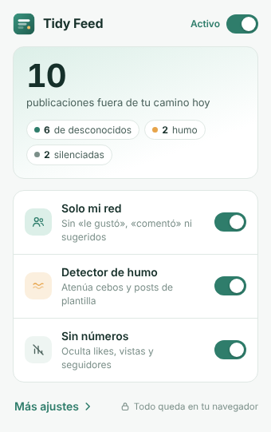

# Sereno

> Tu feed de LinkedIn sin desconocidos, sin humo y sin números.

Extensión de Chrome (Manifest V3). Funciona 100% en el navegador: sin servidores, sin analítica y sin cuentas.



## Qué hace
| Función | Qué hace |
|---|---|
| **Solo mi red** | Oculta «a X le gustó», «X comentó» y los sugeridos. Tiene un modo estricto opcional que deja solo contactos directos. |
| **Detector de humo** | Marca, atenúa u oculta cebos de interacción, historias de plantilla y posts de una frase por renglón. |
| **Sin números** | Oculta likes, comentarios y contadores de seguidores. |
| **Palabras silenciadas** | Oculta posts que mencionan temas que no quieres ver. |
| **Control por persona** | Al pasar el mouse por un post: «Silenciar a X» o «Nunca ocultar a X». Protegido le gana a cualquier filtro. |
| **Ya estás al día** | Tarjeta que corta el scroll cuando empiezas a ver posts que ya viste (3 seguidos) o después de N posts por visita (25 por defecto). Lo que sigue se desenfoca, sin ocultarse, para que LinkedIn no cargue más sin parar. |

Regla fija: **nunca toca la publicidad** (ver [docs/LEGAL.md](docs/LEGAL.md)).

## Probarla en tu Chrome
1. `chrome://extensions` → activar **Modo de desarrollador**.
2. **Cargar extensión sin empaquetar** → elegir esta carpeta.
3. Abrir https://www.linkedin.com/feed/

## Estructura
```
manifest.json
src/
  content/detectors.js   lógica pura de clasificación (testeada en Node)
  content/content.js     aplica la lógica al DOM; selectores centralizados en SEL
  content/content.css    estilos inyectados (prefijo sereno-)
  popup/                 popup de la barra
  options/               página de ajustes y bienvenida
  shared/settings.js     ajustes y estadísticas (chrome.storage)
  shared/ui.*            tokens visuales e i18n
  background/            abre la bienvenida al instalar
_locales/es, en          generados desde scripts/strings.mjs
icons/                   icon.svg → PNG
docs/                    privacidad, ficha de la Store, notas legales, capturas
tests/                   unit (node:test) + e2e (Chromium real con feed simulado)
```

## Comandos
```bash
npm test              # tests unitarios del detector
npm run e2e           # carga la extensión en Chromium sobre un feed simulado
npm run screenshots   # e2e y además genera capturas en docs/screenshots
npm run build         # regenera textos (_locales) e íconos
npm run pack          # genera dist/<nombre>-<versión>.zip para la Store
npm run rename -- "Nuevo Nombre"
```
Los textos se editan en `scripts/strings.mjs`, nunca a mano en `_locales/`. Los tests e2e e íconos usan Playwright.

## Cuando LinkedIn cambie su HTML
Se va a romper cada tanto, es inevitable. Desde noviembre de 2026 LinkedIn usa clases generadas (`k4dl5v`, `k4dayy`…) que cambian con cada versión, así que Sereno **no las usa**. Se apoya en lo más estable:
- el título oculto de cada publicación ("Publicación en el feed"),
- `data-testid="expandable-text-box"` para el texto,
- `aria-label` de los botones y textos visibles ("Promocionado", "sigue esta página", "614 reacciones").

Todo lo que depende del HTML está en el objeto `SEL` de `src/content/content.js`. El diseño falla "hacia mostrar": si un selector deja de funcionar, se ve LinkedIn normal y no se oculta nada por error.

**Cómo diagnosticar:** abrir el feed, F12 → Console, pegar `scripts/diagnose.js`. Descarga `sereno-diagnostico.json` con la estructura real; con eso se actualiza `SEL` y la réplica `tests/fixtures/feed-2026.html`.

## Estado
- [x] MVP funcional con tests unitarios (22) y e2e (feed clásico, feed 2026 y funciones)
- [x] Control por persona y «Ya estás al día» (v0.2.0)
- [ ] Ajustar la posición del botón de Sereno en el LinkedIn real si choca con los botones de LinkedIn
- [x] Adaptado al feed de LinkedIn de nov. 2026 (a partir de un diagnóstico real)
- [ ] Confirmar en el LinkedIn real después del ajuste
- [ ] Definir el nombre definitivo (ver docs/LEGAL.md)
- [ ] Publicar la política de privacidad en una URL pública y completar el email de contacto
- [ ] Imagen promocional de 440×280
